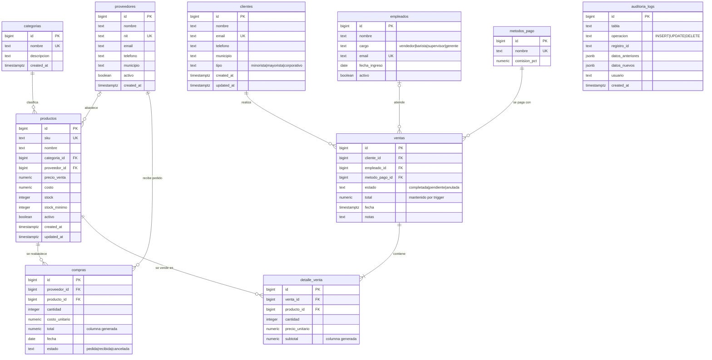

# ☕ Andes Café — Ventas e inventario sobre Supabase + dashboard de Looker Studio

Aplicación web de gestión de ventas e inventario para una tienda de café del Eje Cafetero.
Los datos viven en **PostgreSQL (Supabase)**, la app los lee y escribe directamente desde el navegador
(`supabase-js` + políticas RLS) y el **Home** incrusta un informe interactivo de **Google Looker Studio**
conectado a la misma base de datos.

| Capa | Tecnología |
|---|---|
| Frontend | Vite + JavaScript (ES modules), CSS responsive, sin framework |
| Base de datos | PostgreSQL administrado por Supabase (10 tablas, vistas, triggers, RPC, RLS) |
| Analítica (BI) | Google Looker Studio, conector nativo PostgreSQL |
| Despliegue | Cualquier hosting estático (Vercel / Netlify / GitHub Pages) |

## Funcionalidad

- **Dashboard**: KPIs en vivo (RPC `resumen_kpis`) + informe de Looker Studio embebido en un `<iframe>` responsivo.
- **Ventas**: registro de una venta con varias líneas. Una función transaccional (`registrar_venta`) valida stock, descuenta inventario y recalcula el total. También permite ver el detalle, anular (devuelve stock) y eliminar.
- **Productos, Clientes, Proveedores, Compras**: CRUD completo; todo persiste de inmediato en Supabase.
- **Auditoría**: cada alta/cambio/baja de productos y clientes queda registrada por un trigger (solo lectura en la app).

## Estructura del repositorio

```
andes-cafe/
├── index.html
├── src/
│   ├── main.js            # router por hash + pantalla de configuración
│   ├── supabase.js        # cliente de Supabase (lee variables de entorno)
│   ├── crud.js            # generador de páginas CRUD declarativas
│   ├── ui.js              # utilidades: escape HTML, formato COP, toasts, errores
│   ├── styles.css
│   └── pages/             # home (iframe Looker), ventas, catálogos, auditoría
├── supabase/
│   ├── schema.sql         # ← DDL: tablas, índices, triggers, RPC, vistas, RLS
│   ├── seed.sql           # ← datos de prueba (generado, ver abajo)
│   └── looker_readonly.sql# usuario de solo lectura para Looker Studio
├── tools/generate_seed.py # genera seed.sql de forma determinista
├── docs/ENTREGA.md        # checklist de entrega y guion del video
├── .env.example
└── package.json
```

## 1. Diagrama Entidad-Relación (DER)



> `auditoria_logs` no tiene llave foránea a propósito: es un registro genérico (`tabla` + `registro_id`) que
> sobrevive aunque se borre la fila original.
### Decisiones de diseño

- **Normalización (3FN)**: categorías, proveedores, clientes, empleados y métodos de pago son entidades propias; `ventas` + `detalle_venta` separan encabezado y líneas; `compras` registra el abastecimiento.
- **Integridad referencial**
  - `ON DELETE RESTRICT`: no se puede borrar un cliente, método de pago, producto o proveedor con historial de ventas/compras.
  - `ON DELETE CASCADE`: al borrar una venta se borran sus líneas (`detalle_venta`).
  - `ON DELETE SET NULL`: si se borra un empleado o el proveedor de un producto, el registro histórico se conserva sin referencia.
  - `ON UPDATE CASCADE` en todas las llaves foráneas.
- **Reglas de dominio** con `CHECK` (precios ≥ 0, stock ≥ 0, cantidades > 0, estados y tipos permitidos) y `UNIQUE` (SKU, email, NIT, `(venta_id, producto_id)`).
- **Índices** sobre cada llave foránea y sobre las columnas usadas en filtros de analítica (`ventas.fecha`, `ventas.estado`, `clientes.municipio`…); índice parcial para productos con stock bajo.
- **Lógica en la base de datos**: triggers (`updated_at`, auditoría, total de la venta), funciones RPC transaccionales (`registrar_venta`, `anular_venta`, `resumen_kpis`). `registrar_venta` bloquea las filas de producto con `FOR UPDATE` para impedir sobreventa en concurrencia.
- **Vistas para BI**: `vw_ventas_detalle` (una fila por línea, ya con todas las dimensiones y el margen), `vw_ventas_resumen` y `vw_inventario`.
- **Seguridad**: RLS activado en todas las tablas; las vistas analíticas no se exponen por la API pública; Looker usa un rol propio de solo lectura.

## 2. Ejecución local

**Requisitos:** Node.js ≥ 20.19 (o ≥ 22.12) y una cuenta gratuita en [supabase.com](https://supabase.com).

```bash
git clone <URL-DEL-REPO> andes-cafe
cd andes-cafe
npm install
cp .env.example .env      # completa los valores (ver sección 3)
npm run dev               # http://localhost:5173
```

Scripts: `npm run dev` (desarrollo) · `npm run build` (genera `dist/`) · `npm run preview` (sirve el build).

> Si abres la app sin `.env`, verás una pantalla que te indica qué variables faltan.

## 3. Configurar Supabase

1. **Crear proyecto**: *New project* → elige región cercana (p. ej. South America – São Paulo) y guarda la contraseña de la base de datos.
2. **Crear el esquema**: *SQL Editor → New query* → pega y ejecuta `supabase/schema.sql`.
   Es idempotente: puedes volver a ejecutarlo (borra y recrea todo).
3. **Cargar datos**: nueva consulta → pega y ejecuta `supabase/seed.sql`.
   Deja el esquema con este volumen:

   | Tabla | Registros | | Tabla | Registros |
   |---|---:|---|---|---:|
   | categorias | 6 | | ventas | **160** |
   | proveedores | 8 | | detalle_venta | **527** |
   | productos | 40 | | compras | **55** |
   | clientes | 60 | | auditoria_logs | **48** |
   | empleados | 8 | | metodos_pago | 5 |

   Los datos son **asimétricos a propósito** (para que los gráficos tengan forma): pocos productos concentran las ventas, los clientes corporativos/mayoristas compran mucho más, hay picos en marzo y septiembre, Efectivo y Nequi dominan los pagos y hay productos con stock bajo o agotado.
4. **Variables de entorno**: *Project Settings → API* → copia la **Project URL** y la clave **anon/publishable** a tu `.env`:

   ```env
   VITE_SUPABASE_URL=https://<project-ref>.supabase.co
   VITE_SUPABASE_ANON_KEY=<anon-key>
   VITE_LOOKER_EMBED_URL=<se completa en la sección 4>
   ```

   La clave `anon` es pública por diseño (viaja al navegador); lo que protege los datos son las políticas RLS.
   **Nunca** pongas la `service_role` key en el frontend ni en el repositorio.
5. **Comprobar la persistencia**: ejecuta `npm run dev`, registra una venta o crea un producto y verifica en *Table Editor* que la fila apareció al instante.


## 4. Dashboard en Looker Studio


### 4.1 Conectar la fuente de datos

1. En [lookerstudio.google.com](https://lookerstudio.google.com) → **Crear → Fuente de datos → PostgreSQL**.
2. En Supabase pulsa **Connect** (arriba) → pestaña *Session pooler* y copia los datos:

   | Campo en Looker Studio | Valor |
   |---|---|
   | Host | el host del *Session pooler* (`aws-…​.pooler.supabase.com`) |
   | Puerto | `5432` |
   | Base de datos | `postgres` |
   | Nombre de usuario | `postgres` |
   | Contraseña | la que definiste en Supabase |
   | SSL | activado; si lo pide, sube el certificado de *Project Settings → Database → SSL Configuration* |

   > **Importante:** la conexión directa (`db.<ref>.supabase.co`) usa IPv6 y Looker Studio no puede alcanzarla. Usa el **Session pooler**, que es IPv4. Con el pooler el usuario lleva el sufijo `.<project-ref>`.
3. Autentica y agrega la tabla (vista) **`vw_ventas_detalle`** (fuente principal). Opcionalmente agrega `vw_inventario` como segunda fuente.
4. En la fuente de datos, revisa los tipos: `fecha` → *Fecha*, `ingreso`/`margen`/`costo_total` → *Número (moneda COP)*.


### 4.3 Habilitar la incrustación y compartir

1. En el informe: **Archivo → Insertar informe → Habilitar la incrustación**.
2. Elige **URL de inserción** y copia la URL (`https://lookerstudio.google.com/embed/reporting/<ID>/page/<PÁGINA>`).
3. **Compartir → Administrar acceso → "Cualquier persona con el enlace puede ver"**. Sin esto, el iframe pedirá iniciar sesión en Google.
4. Pega la URL en `VITE_LOOKER_EMBED_URL` (local y en el hosting).

> Si tu cuenta es de una organización (Google Workspace institucional) y no te deja compartir con "cualquier persona", el administrador lo restringe: crea el informe con una cuenta personal de Google.

## 5. Integración en la interfaz web

El Home (`src/pages/home.js`) incrusta el informe así:

```html
<div class="embed">
  <iframe title="Dashboard de ventas en Looker Studio" src="…/embed/reporting/…" loading="lazy" allowfullscreen
          sandbox="allow-storage-access-by-user-activation allow-scripts allow-same-origin allow-popups allow-popups-to-escape-sandbox"></iframe>
</div>
```

- **Responsivo**: el contenedor usa `aspect-ratio: 16/10` con `min-height` en escritorio y pasa a `78vh` en móvil; el iframe ocupa el 100 % del contenedor (`src/styles.css`, sección *Looker Studio embebido*). No genera desbordamiento horizontal.
- **Seguro**: la URL se valida antes de usarse (solo `https` y solo `lookerstudio.google.com` / `datastudio.google.com`) y acepta tanto la URL de inserción como la normal del informe.
- Si `VITE_LOOKER_EMBED_URL` está vacía, el Home muestra un recuadro con instrucciones en lugar de romper la página.

## 6. Despliegue

Las variables `VITE_*` se **incrustan en el momento del build**, así que deben existir en el hosting *antes* de compilar (y hay que volver a desplegar si las cambias).

**Vercel** (recomendado)
1. Sube el proyecto a GitHub.
2. [vercel.com/new](https://vercel.com/new) → importa el repo (detecta Vite automáticamente: build `npm run build`, salida `dist`).
3. *Environment Variables*: agrega `VITE_SUPABASE_URL`, `VITE_SUPABASE_ANON_KEY` y `VITE_LOOKER_EMBED_URL`.
4. *Deploy*. La app usa rutas con `#`, por lo que no necesita reglas de reescritura.

**Netlify**: *Add new site → Import from Git*, build `npm run build`, directorio `dist`, mismas variables.

**GitHub Pages**: `vite.config.js` ya usa `base: './'`; compila en una acción de GitHub pasando las variables como *secrets* y publica `dist/`.


